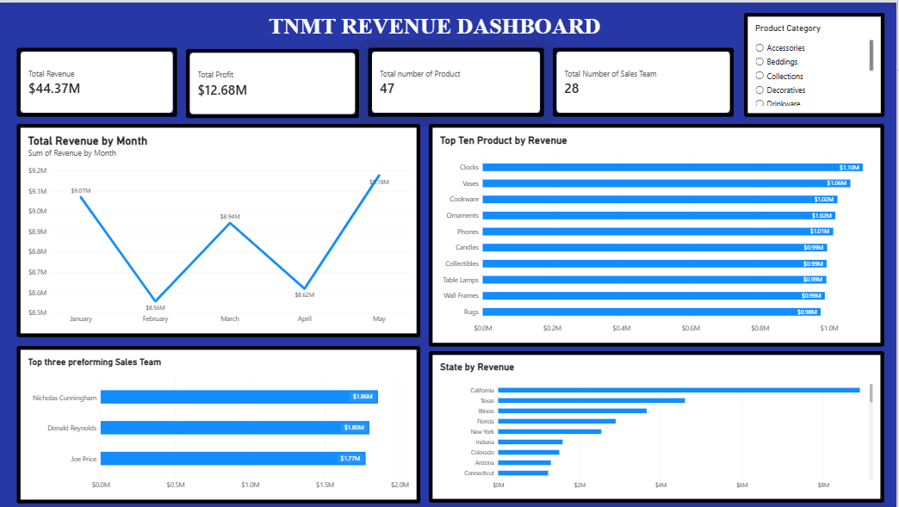

# TNMT Revenue Dashboard | Power BI

An interactive **Power BI revenue and sales performance dashboard** designed to turn business data into clear, actionable insights. The dashboard brings key revenue, profitability, product, sales-team, and geographic metrics together in one place to support faster, more informed business decisions.



## Project Overview

The **TNMT Revenue Dashboard** provides a consolidated view of business performance. It highlights headline KPIs and uses trend and ranking visuals to make it easier to identify revenue patterns, top-performing products, leading sales representatives, and the states contributing most to revenue.

The report also includes a **Product Category** filter, allowing users to explore the dashboard by category and examine performance from different perspectives.

## Key Metrics at a Glance

The dashboard currently reports:

| KPI | Dashboard result |
|---|---:|
| Total Revenue | **$44.37M** |
| Total Profit | **$12.68M** |
| Number of Products | **47** |
| Number of Sales Team Members | **28** |

*Figures shown are the values displayed in the dashboard screenshot.*

## Dashboard Highlights

### 1. Total Revenue by Month
Tracks monthly revenue from January to May, helping users spot changes in performance and identify stronger or weaker months.

### 2. Top 10 Products by Revenue
Ranks products by revenue contribution, making it easier to see which product lines are driving sales.

### 3. Top Three Performing Sales Team Members
Highlights the three sales representatives with the highest revenue in the report, offering a quick view of individual sales performance.

### 4. State by Revenue
Compares revenue across states to show where sales are concentrated and which markets contribute most to overall performance.

### 5. Product Category Filter
Provides an interactive category slicer so users can focus the report on selected product categories.

## Tools & Skills Demonstrated

- **Microsoft Power BI** — dashboard design, report building, and interactive data exploration
- **Data visualization** — selecting appropriate visuals to communicate trends, comparisons, and rankings
- **Business analysis** — translating sales and revenue data into performance indicators
- **Dashboard storytelling** — organizing multiple business perspectives into a single report

> Add or edit this list to reflect the exact techniques used in your project (for example, Power Query, DAX measures, data modelling, or a particular data source).

## Business Value

This dashboard is intended to help stakeholders:

- Monitor overall revenue and profit at a glance.
- Understand how revenue changes over time.
- Identify products that contribute most to sales.
- Compare sales-team performance.
- Explore revenue distribution across states.
- Filter results by product category for more focused analysis.

## Repository Contents

```text
TNMT-Revenue-Dashboard/
├── README.md
└── Tnmt_dashboard.png
```

If you also publish the Power BI `.pbix` file, you can add it to this repository (or link to a downloadable copy) so visitors can explore the report beyond the screenshot.

## How to View

1. Open the dashboard image above to view the report preview.
2. If the `.pbix` file is included, download it.
3. Open the file in **Microsoft Power BI Desktop** to interact with the report and explore its filters and visuals.

## Project Status

**Completed** — dashboard visuals and KPI summary are presented in the report preview.

## Author

**Your Name**  
*Aspiring Data Analyst | Power BI*

Connect with me on [LinkedIn](https://www.linkedin.com/) or explore more of my work in my GitHub repositories.

---

*Thank you for taking the time to review my project. Feedback and suggestions are welcome.*
